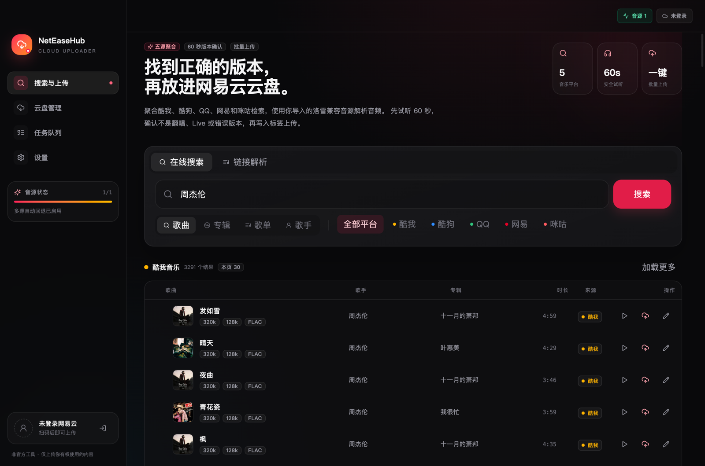
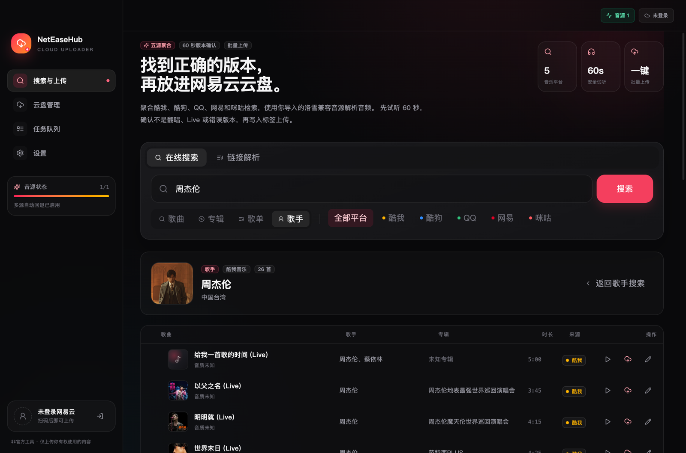
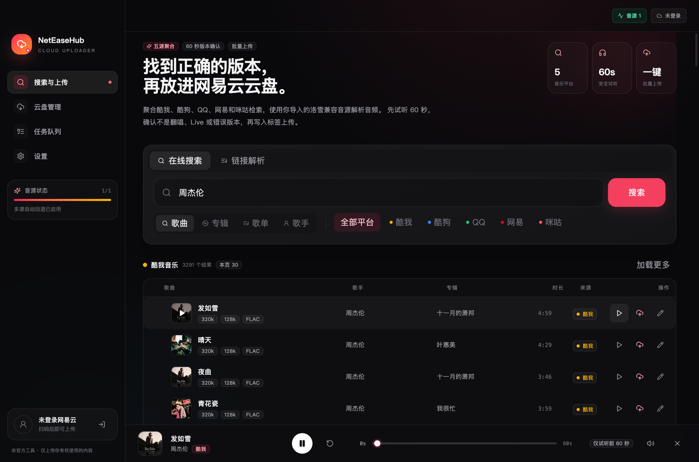

# NetEaseHub

网易云音乐云盘上传中心，支持 macOS 与 Windows。

NetEaseHub 把「找歌 → 试听确认版本 → 整理标签 → 批量上传到网易云云盘」放在一个桌面应用里。应用内置酷我、酷狗、QQ 音乐、网易云音乐、咪咕音乐的歌曲、专辑、歌单与歌手搜索，并兼容洛雪音乐助手的自定义音源脚本，由脚本负责解析实际音频地址。

> 非官方工具。NetEaseHub 与网易云音乐、洛雪音乐助手无隶属关系。请仅下载、试听和上传你有权使用的内容。

## 界面预览

| 五平台歌曲聚合搜索 | 专辑 / 歌单 / 歌手检索 |
| --- | --- |
|  |  |

| 精确歌手曲目 | 60 秒试听与批量上传 |
| --- | --- |
|  |  |

## 功能

- 网易云音乐扫码登录，登录凭证通过系统安全存储加密
- 五大音乐平台聚合搜索歌曲、专辑、歌单和歌手
- 按平台歌手 ID 查看精确歌手曲目
- 导入多个洛雪兼容音源脚本，按优先级自动回退
- 专辑、公开歌单链接/ID 解析
- 60 秒版本试听，自动在第 60 秒停止
- 上传前编辑标题、歌手、专辑、音轨、年份、流派、封面和歌词
- 单曲快速上传、专辑/歌单批量上传
- 下载、写标签、MD5 云盘去重、流式上传与失败重试
- 云盘歌曲列表、删除、网易云曲目匹配与取消匹配
- 智能匹配建议，必须人工确认后应用

## 技术栈

- Electron 42
- React 19 + TypeScript
- electron-vite + Tailwind CSS 4
- `@neteasecloudmusicapienhanced/api`
- `music-metadata`（读写音频标签）
- Zustand + TanStack Query

## 开发

环境要求：

- Node.js 24+
- pnpm 11+

```bash
pnpm install
pnpm dev
```

Electron 首次安装需要下载对应平台运行时。如果 Electron 安装脚本被包管理器拦截，请允许 `electron` 与 `electron-winstaller` 执行安装脚本。

## 校验

```bash
pnpm typecheck
pnpm lint
pnpm test
pnpm test:e2e
pnpm build
```

端到端测试使用 Playwright Electron，首次运行需要先生成 `out/` 构建产物。
`pnpm test:e2e` 会先串行执行 `install-electron`，避免多个 Playwright worker 并发下载 Electron 运行时。

真实平台连通性冒烟：

```bash
pnpm smoke:providers
```

该命令会启动桌面应用，真实请求五个平台的歌曲、专辑、歌单、歌手与歌手曲目接口，并在任一平台无结果或报错时返回失败。

## 打包

```bash
# macOS arm64 + x64
pnpm pack:mac

# Windows x64
pnpm pack:win
```

产物输出到 `release/`。

当前默认未签名：

- macOS 可能触发 Gatekeeper 提示
- Windows 可能触发 SmartScreen
- 更新检查会跳转到 GitHub Releases

配置 Apple Developer 或 Windows 代码签名证书后，可进一步启用系统签名、公证和 electron-updater 自动更新。

## 真实账号冒烟清单

发布前使用自己的网易云账号和可信音源脚本验证：

- 扫码登录、重启后登录态恢复、退出登录
- MP3 与 FLAC 上传，中文标题/歌手/专辑
- 封面、歌词写入后下载文件复核标签
- 五个平台搜索、专辑和公开歌单解析
- 搜索结果、专辑与歌单试听；第 60 秒停止；切换歌曲停止旧试听
- 单曲快速上传、专辑/歌单批量上传、超过 50 首二次确认
- 相同 MD5 文件跳过，以及“仍然上传”
- 断网/音源失败后的任务重试
- 退出应用后重启，中断任务恢复为等待中
- 云盘分页加载、删除、匹配建议确认与取消匹配

网易云接口和第三方音源均可能随平台调整而失效，真实账号测试不能由固定 fixture 完全替代。

## 音源脚本

NetEaseHub 兼容洛雪音乐助手的自定义音源协议：

- 脚本在隐藏的隔离 BrowserWindow 中运行
- 脚本通过 `globalThis.lx` 与应用通信
- 搜索、专辑和歌单解析由应用内置完成
- 脚本负责返回 `musicUrl`，可选提供 `lyric` 和 `pic`

音源脚本属于第三方代码，拥有向外部 HTTP/HTTPS 地址发起请求的能力。请只导入可信来源。

## 网易云云盘元数据限制

网易云云盘完成上传接口只接收：

- 标题
- 歌手
- 专辑

封面、歌词、音轨号、年份、流派等会写入上传的音频文件标签。已上传歌曲不能通过公开接口任意改写元数据，只能：

1. 使用「云盘匹配」绑定到网易云曲目，由网易云曲目信息更新显示字段
2. 或删除后重新上传

## 目录结构

```text
src/main       Electron 主进程、网易云 API、平台检索、音源运行时、上传队列
src/preload    IPC 桥、洛雪音源运行时 preload
src/renderer   React 界面
src/shared     共享类型、校验、工具函数
tests          单元测试与 Playwright Electron 测试
```

## 许可证

项目使用 Apache-2.0。第三方依赖和参考实现的声明见 [THIRD_PARTY_NOTICES.md](./THIRD_PARTY_NOTICES.md)。
